# Smart Document Scanner & OCR

**A computer-vision document scanner with perspective correction, image enhancement, and deep-learning OCR — explored experimentally and delivered through an interactive Streamlit interface.**

    

**Developer:** [Maen Qawasmeh](https://github.com/Maen-Qawasmeh)  
**Source code:** [GitHub repository](https://github.com/Maen-Qawasmeh/Smart-Document-Scanner-OCR-)  
**Live demo:** [Try the interactive Streamlit app](https://b3x5qyi3y6karuj9hfbprv.streamlit.app/)

---

## Live demo

**[🚀 Launch Smart Document Scanner & OCR](https://b3x5qyi3y6karuj9hfbprv.streamlit.app/)**

Try the application in your browser—no local Python installation is required. Upload a JPG or PNG document, optionally enable document scanning for perspective correction, choose **Original**, **Grayscale**, **CLAHE**, or **Adaptive Thresholding**, and click **Scan & Extract Text**.

The hosted demo displays detected text and per-segment confidence scores. You can export **TXT**, **JSON**, and a **scanned PNG**. These three download controls were exercised successfully during cloud testing.

> **Deployment note:** The cloud application uses lightweight `PP-OCRv5_mobile_det` and `en_PP-OCRv5_mobile_rec` models for CPU inference. The notebook's historical FUNSD experiments used a different (medium) model configuration; their CER/WER numbers should not be interpreted as evaluation metrics for the hosted mobile models. The demo runs on shared cloud resources, so cold starts and model initialization may take extra time.

## Overview

A document photographed on a phone is rarely ready for OCR: the page can be rotated, viewed in perspective, unevenly illuminated, or surrounded by a visually distracting background. This project combines **classical image processing** with **PaddleOCR** to turn document photos into top-down scans and searchable, exportable text.

The repository also contains a Jupyter research notebook investigating *when preprocessing helps, when it hurts, and why small text is challenging*. The experimental analysis includes FUNSD ground-truth annotations, character- and word-level error rates, spatial matching of recognized regions, and upscaling of low-resolution table headers.

### Real-world example — mobile document photo

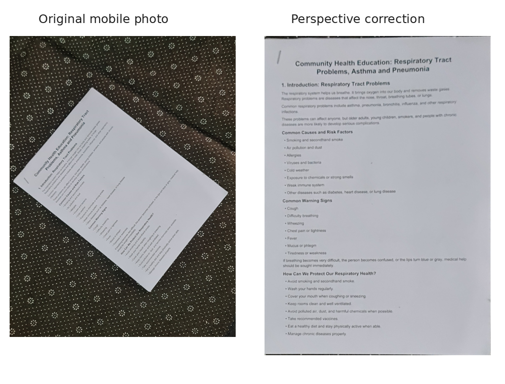

*The right-hand image was reconstructed from the supplied sample photo using the repository's documented grayscale → Gaussian blur → Otsu → morphological closing → four-point perspective-correction procedure. It demonstrates geometry correction, not a claim of perfect OCR.*

## Features

| Feature | What it does |
| --- | --- |
| **Document boundary detection** | Finds a large, convex four-corner contour with OpenCV |
| **Perspective correction** | Maps an angled paper document to an upright rectangular view |
| **Selectable preprocessing** | Original, grayscale, CLAHE, and adaptive thresholding |
| **Text detection and recognition** | Runs PaddleOCR on the selected document representation |
| **Confidence inspection** | Displays recognized segments, per-segment scores, and mean/minimum confidence |
| **Downloadable results** | Saves recognized text as TXT, structured predictions as JSON, and the scanned page as PNG |
| **Session-aware interface** | Retains displayed results across Streamlit reruns and flags changed settings |
| **Experimental evaluation** | Compares CER, WER, word-region coverage, and image upscaling in `experiments.ipynb` |

> **Scope:** The application is an OCR/scanning prototype. Research-notebook experiments (ground-truth scoring, spatial matching, and ROI upscaling) are **not** automatically executed for every image uploaded to the web application.

## System architecture

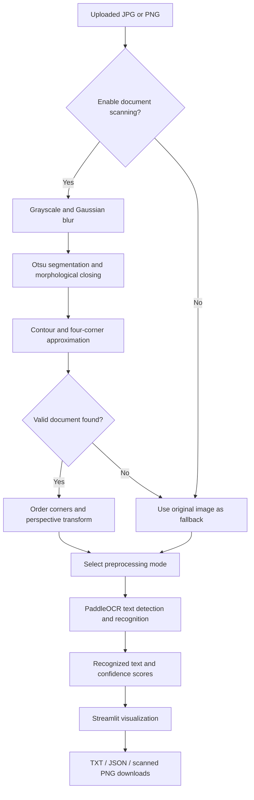

### 1. Detect and scan documents

The document scanning component uses **grayscale conversion**, **5×5 Gaussian blur**, **Otsu binarization**, **7×7 morphological closing**, **external contours**, **minimum contour area filtering** (15% of the image area), and **polygon approximation** (`approxPolyDP` with an epsilon of 2% of the contour perimeter). A suitable convex quadrilateral is ordered as top-left → top-right → bottom-right → bottom-left and passed to `getPerspectiveTransform` / `warpPerspective`.

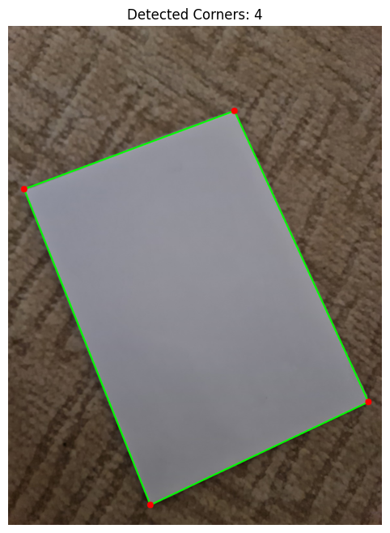

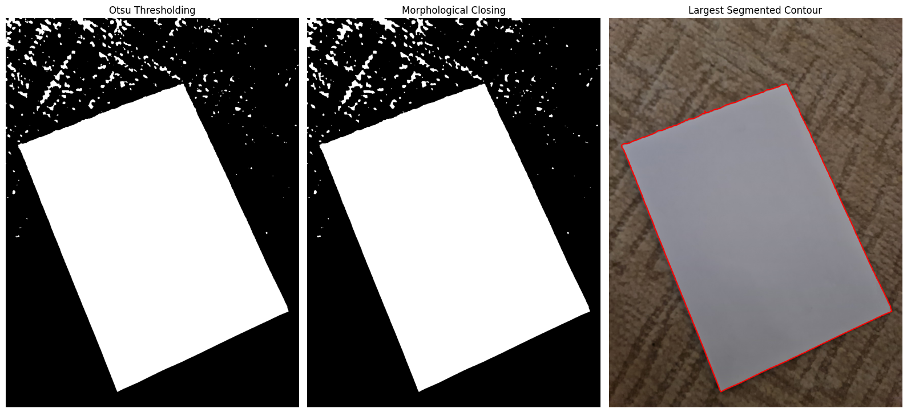

The notebook initially explored Canny edges and edge-based morphological closing; the experiment demonstrated a failure to obtain four reliable corners in one case. Otsu-based foreground segmentation subsequently recovered a usable quadrilateral.

<details>
<summary>View the earlier edge-based experiment</summary>

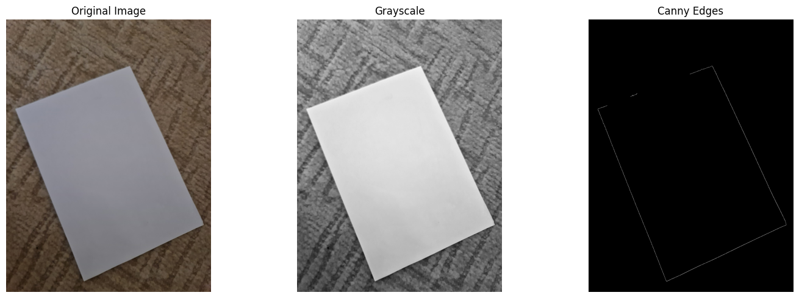

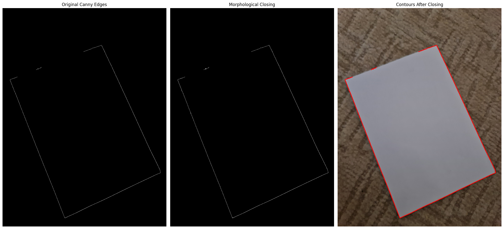

</details>

### 2. Preprocess for OCR

The application lets the user compare four input representations rather than assuming that aggressive thresholding is always optimal.

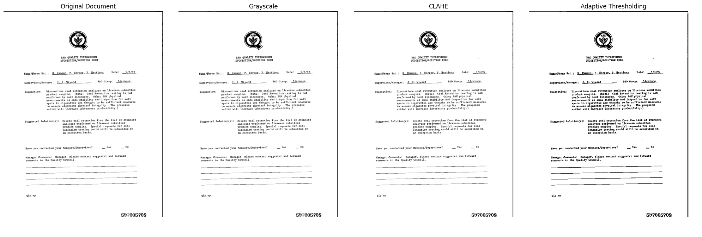

- **Original** preserves native document pixels.
- **Grayscale** removes color channels.
- **CLAHE** increases local contrast; notebook experiments use `clipLimit=2.0` and `tileGridSize=(8, 8)`.
- **Adaptive thresholding** produces a locally binarized image using a Gaussian window; the notebook uses block size `31` and constant `10`.

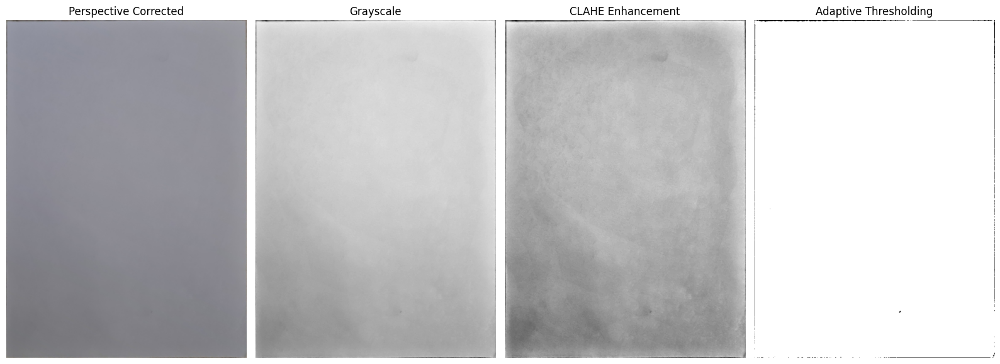

### 3. Extract text with PaddleOCR

The recorded notebook experiments initialize English, CPU-based PaddleOCR with automatic document orientation classification, unwarping, and text-line orientation disabled. Notebook logs show cached `PP-OCRv6_medium_det` and `PP-OCRv6_medium_rec` models in that experimental environment.

For the **public Streamlit deployment**, the OCR engine was configured with `PP-OCRv5_mobile_det` and `en_PP-OCRv5_mobile_rec`, `enable_mkldnn=False`, and `cpu_threads=2` to make CPU-hosted inference more practical. The application displays the recognized text segments and confidence scores returned by the engine.

**Important:** OCR confidence measures the model's internal confidence, **not** recognition accuracy against a verified reference.

## Streamlit application

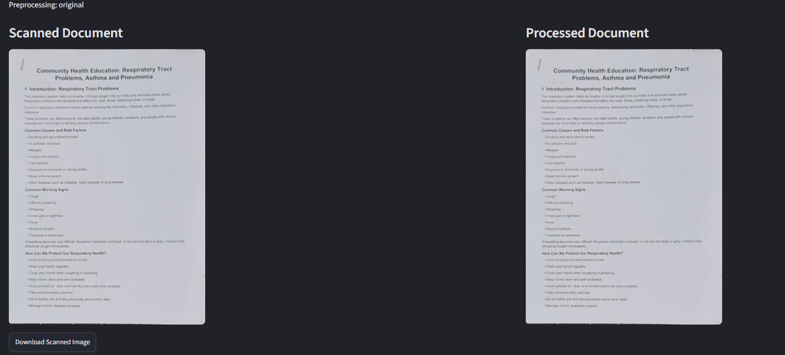

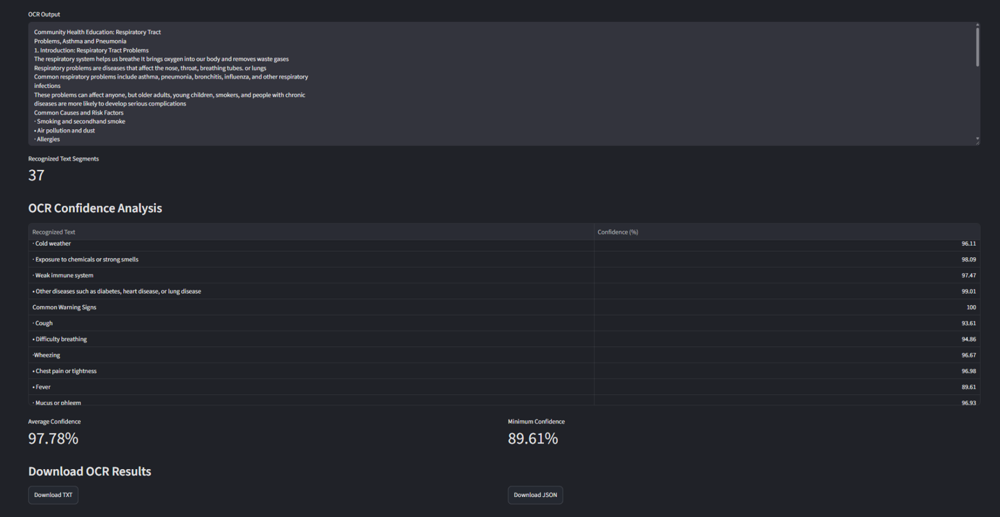

From the interface, users can upload a JPG/PNG, optionally turn on document scanning, choose the image preprocessing mode, click **Scan & Extract Text**, inspect recognized text and scores, and download TXT, JSON, or a scanned PNG. The original-mode OCR is evaluated directly on the uploaded or perspective-corrected pixels.

### Cloud demo smoke tests (October 2026)

The public demo was tested with a real phone photograph of a tilted respiratory-health document. With document scanning enabled, the app visibly straightened and cropped the page and completed OCR under multiple preprocessing modes. An additional scanned form was successfully processed online, producing **29 text segments**, **98.77% mean confidence**, and **96.61% minimum confidence**.

On the tilted mobile document, the observed cloud results included:

| Preprocessing | Recognized text segments | Average confidence | Minimum confidence |
| --- | ---: | ---: | ---: |
| Grayscale | 37 | 97.39% | 90.83% |
| CLAHE | 37 | 97.63% | 92.64% |

These values come from individual hosted-app test runs; they are **confidence statistics, not ground-truth recognition accuracy**. CLAHE's slightly higher confidence here does not establish a lower CER or WER. Scanning, OCR display, and TXT/JSON/scanned-PNG downloads were also exercised in the deployed interface.

## Experimental evaluation

The repository notebook (`experiments.ipynb`) contains a small evaluation using the [FUNSD dataset](https://guillaumejaume.github.io/FUNSD/), which provides scanned forms and word-level annotations. Experiments were run on a single training image and on **five of the 50 available test documents** (selected using `test_images[:5]`). The numbers below are therefore **exploratory subset results**, not generalizable model benchmarks.

### A. Single-document preprocessing comparison

The selected FUNSD training image produced 28 detected text segments under each preprocessing variant.

| Method | Text segments | Avg. confidence | CER ↓ | WER ↓ |
| --- | ---: | ---: | ---: | ---: |
| Original | 28 | 99.41% | 0.44% | 4.76% |
| Grayscale | 28 | 99.41% | 0.44% | 4.76% |
| CLAHE | 28 | 99.43% | 0.44% | 4.76% |
| Adaptive thresholding | 28 | 96.35% | 3.17% | 22.86% |

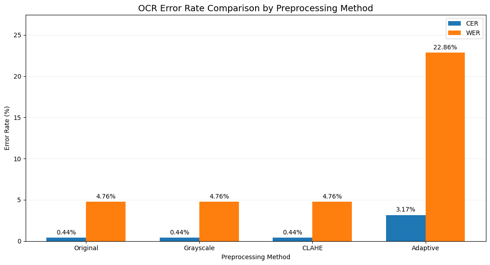

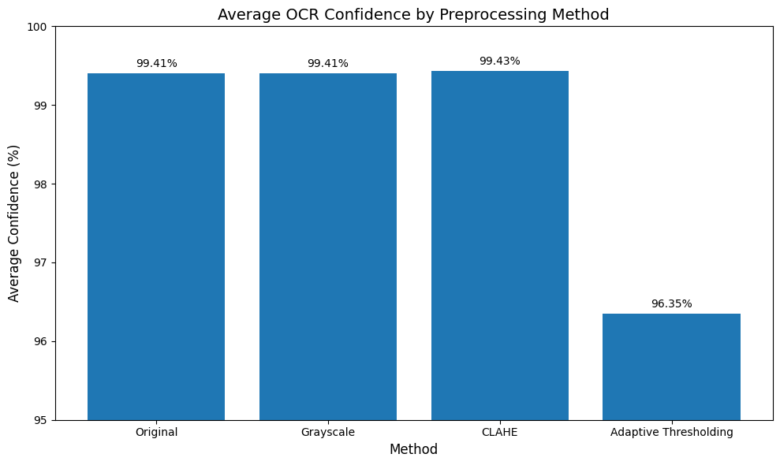

Adaptive thresholding substantially worsened text recognition on this example, even though it detected the same number of segments. Segments and confidence alone therefore cannot tell us whether text is correct.

### B. Five-document FUNSD test subset

The notebook evaluates five test-image/annotation pairs, using a common reference-text normalization and `jiwer` CER/WER. Results are **unweighted averages of per-document error rates**, not a corpus-wide pooled score.

| Method | Mean CER ↓ | Mean WER ↓ | Mean detected segments |
| --- | ---: | ---: | ---: |
| Original | 6.14% | 20.76% | 45.2 |
| Grayscale | 6.14% | 20.76% | 45.2 |
| CLAHE | **6.13%** | **20.65%** | 45.2 |
| Adaptive thresholding | 11.69% | 38.58% | 42.4 |

**Interpretation:** CLAHE produced a very small average improvement relative to the unmodified image on this five-document subset; the adaptive-thresholding variant performed worse on average. This is not evidence that one setting is optimal for every document.

**Metric definitions:** Character Error Rate (CER) and Word Error Rate (WER) are edit-error measures relative to ground truth; **lower is better**. The notebook normalizes case, whitespace, and selected punctuation spacing before scoring. Reading-order reconstruction and segmentation differences can still affect results.

### C. Spatial matching and error analysis

The notebook compares FUNSD **ground-truth word boxes** with PaddleOCR **recognized text-region boxes**. The overlap measure is *intersection area divided by ground-truth word area* — **not** Intersection over Union (IoU), and not character recognition correctness.

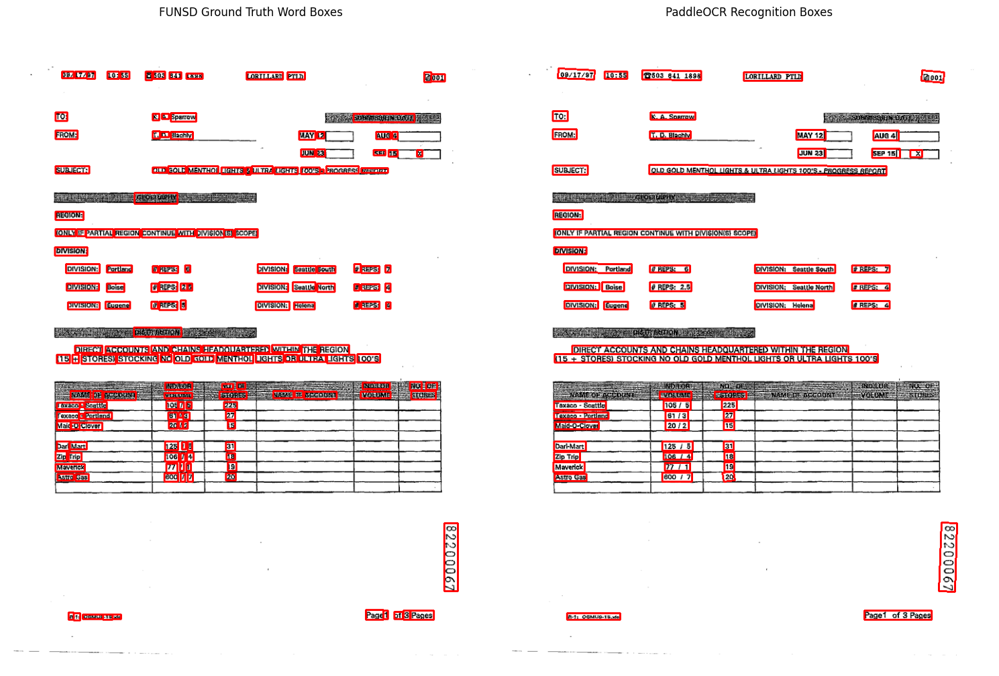

For one examined document with **167 annotated words**, **155** had a region overlap of at least **0.50** (**92.81% spatial coverage**); **12** were unmatched. At a stricter overlap threshold of **0.90**, coverage fell to **138/167 (82.63%)**. Multiple words can match one larger OCR region, so this is a localization diagnostic, not word-recognition precision or recall.

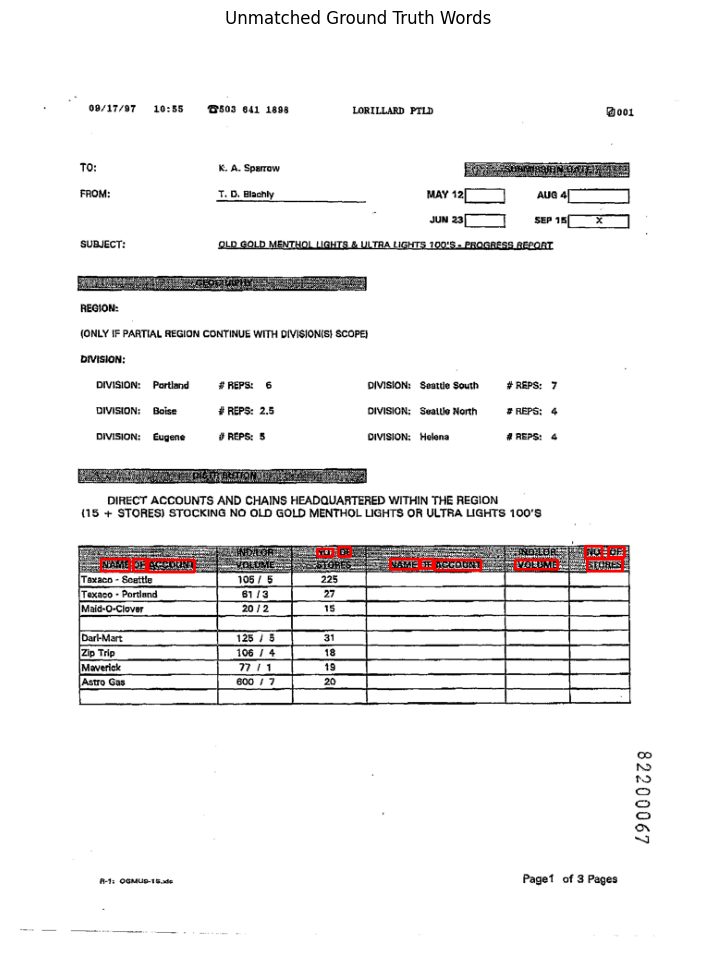

The unmatched words cluster around a densely printed table header, motivating the targeted ROI-upscaling experiment below.

### D. Low-resolution table-header upscaling

A cropped table-header region was resized using **bicubic interpolation** at 1×, 2×, 3×, and 4× prior to OCR.

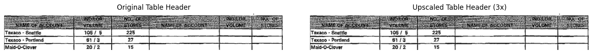

| Scale | Detected text segments | Avg. confidence | Exact reference phrases recovered (of 3) |
| --- | ---: | ---: | ---: |
| 1× | 8 | 95.82% | 0 |
| 2× | 9 | **96.81%** | 0 |
| 3× | 19 | 93.59% | **1** |
| 4× | 15 | 95.26% | 0 |

At 3×, PaddleOCR recovered the phrase `NAME OF ACCOUNT`, but also introduced extra incorrect text fragments. Upscaling can reveal missed small text; higher scale does not automatically improve transcription quality or confidence.

## Project structure

```text
Smart-Document-Scanner-OCR/
├── app.py                      # Streamlit web interface
├── main.py                     # Document-scanning CLI/example script
├── experiments.ipynb           # Notebook: OCR metrics & image experiments
├── src/
│   ├── document_scanner.py     # Boundary detection and perspective correction
│   ├── image_preprocessing.py  # Grayscale, CLAHE, adaptive thresholding
│   ├── ocr_engine.py           # PaddleOCR wrapper
│   ├── pipeline.py             # Unified scanning → preprocessing → OCR
│   └── export_utils.py        # TXT / JSON export helper
├── sample_images/              # Public sample photographs
├── assets/                     # README figures and UI screenshots
├── test_ocr.py                 # Dataset-dependent manual smoke tests
├── test_pipeline.py
├── test_unified_pipeline.py
├── requirements.txt
├── packages.txt                 # Linux system dependencies for cloud deployment
└── .gitignore
```

`dataset/` and `outputs/` are intentionally excluded from Git. Several `test_*.py` files are manual scripts rather than an automated `pytest` suite; they expect FUNSD data in `dataset/`.

## Run locally

**Development environment:** Python 3.12 with CPU PaddlePaddle/PaddleOCR. The Streamlit Community Cloud deployment has completed a successful Linux installation and interactive OCR smoke tests. This does not constitute a reproducible clean-install test on every operating system or a production reliability guarantee.

```bash
# Clone the public repository
 git clone https://github.com/Maen-Qawasmeh/Smart-Document-Scanner-OCR-.git
 cd Smart-Document-Scanner-OCR-

# Install Python packages (model/runtime compatibility may vary)
 python -m pip install -r requirements.txt

# Start the app
 python -m streamlit run app.py
```

Open the local Streamlit address shown in the terminal (typically `http://localhost:8501`). On first run, PaddleOCR may need to download model weights and initialize its inference engine. An internet connection is required for any missing models.

For dataset-dependent notebook work, obtain FUNSD from its source, observe its usage terms, and place images/annotations under the paths referenced in the notebook (for example, `dataset/training_data/images/` and `dataset/testing_data/annotations/`). The app itself accepts uploaded JPG, JPEG, and PNG images without requiring FUNSD.

## Limitations and engineering trade-offs

- **Contour detection is heuristic.** Complex textures, shadows, low-contrast paper, and partial pages can cause missed or incorrect quadrilaterals. Visual validation matters.
- **Small text and tables** can be missed or merged across OCR regions. The notebook's ROI experiment demonstrates both gains and artifacts after scaling.
- **Confidence ≠ accuracy.** CER/WER require annotated ground truth and should not be inferred from confidence percentages.
- **Reading order:** The notebook's geometry-based reconstruction can merge columns or split/merge lines; resulting CER/WER reflect both OCR and alignment decisions.
- **CPU inference / hosting:** The public demo has successfully run on Streamlit Community Cloud with mobile OCR models, but shared hosting, memory limits, model downloads, and cold starts can still affect availability and latency.
- **Input scope:** JPG/JPEG/PNG single-image processing; multi-page PDF import, key-value extraction, and dedicated table structure recovery are not implemented in the current app.

## Future improvements

- Score document candidates more robustly and reject spurious four-corner detections.
- Evaluate on a larger and more diverse sample, including mobile photos with ground truth.
- Add structured document understanding, table reconstruction, and reading-order correction.
- Explore targeted upscaling and OCR retries for difficult small-text regions.
- Add multi-page PDF support and optional language/model selection.
- Further pin and validate cloud dependencies, improve startup performance, and add monitoring and failure handling before positioning the demo as a production service.

## License and reuse

No license file has been selected or added to the repository. Public visibility alone does not grant a software license. Third-party datasets and model weights retain their respective usage terms.

---

**Built by [Maen Qawasmeh](https://github.com/Maen-Qawasmeh)** — combining computer vision, OCR, practical application development, and measured experiments.
